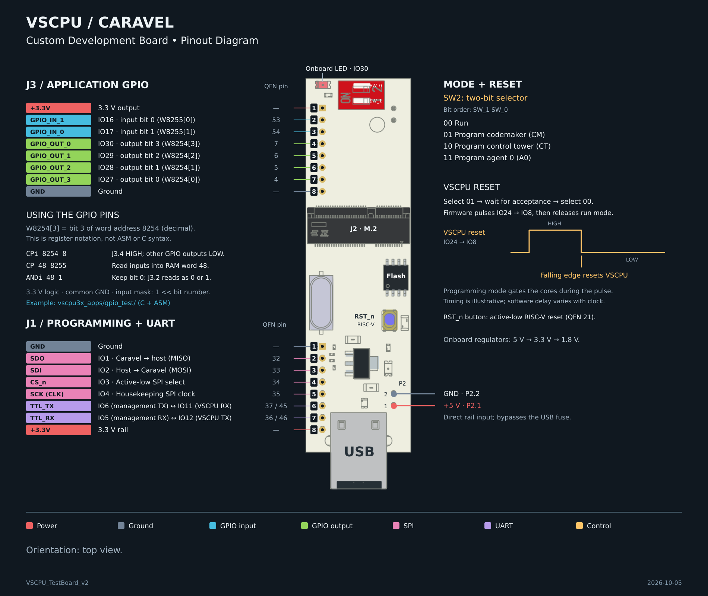

# Caravel VSCPU3x Board

This repo is a customized version of Caravel Board repo that provides examples for VSCPU3x.

Refer to [quickstart guide](vscpu3x_docs/Quickstart.md) for an example test environment.

## Uploading Applications over USB

Applications are uploaded to the VSCPU cores over the board's USB serial port
(a CH340 chip). **No programmer hardware is needed for this** — only a USB cable
and Python 3 with `pyserial`. An FTDI programmer is needed solely to rebuild the
management firmware, which is already flashed on the board.

```bash
pip3 install pyserial

cd vscpu3x_apps/utils
python3 run_test.py oled_test /dev/ttyUSB0 --memclear
```

`run_test.py` asks you to set `PGM_SEL_SW` for each core it programs; set the
switch, wait a second, and press Enter. When the upload finishes, set the switch
back to `2'b00` and the program starts. See the
[quickstart guide](vscpu3x_docs/Quickstart.md) for the switch table and the file
naming convention.

**Finding the serial port.** On Linux the board appears as `/dev/ttyUSB0`
(`ls /dev/ttyUSB*` after plugging it in). If opening it fails with "permission
denied", add yourself to the serial group and log in again:
`sudo usermod -aG dialout $USER` (the group is `uucp` on Arch). On Windows, use
the COM port shown in Device Manager, e.g. `COM3`; on macOS, use
`/dev/cu.wchusbserial*`. Windows and macOS may need the CH340 driver.

| Application | What it does | Needs on J3 |
|---|---|---|
| `oled_test` | Fills an SSD1306 panel white — the simplest check that output works | SSD1306 OLED |
| `oled_photo` | Draws a still image | SSD1306 OLED |
| `flappy` | A dot that jumps while the button on `GPIO_IN[0]` is held, and falls when released | SSD1306 OLED, button |
| `gpio_test` | Memory-mapped I/O example: relays two inputs to two outputs and drives two more as a quadrature pair | Switches on the inputs, LEDs or a logic analyzer on the outputs |
| `knightrider` | Sweeps a lit pattern across `GPIO_OUT` | LEDs on the outputs |
| `bubble_sort` | Sorts an array on the codemaker and control tower; has `_chk.mem` files, so `run_test.py` verifies the result | Nothing |

The J3 pins are in the [pinout](#pinout) below.

**If an upload fails** with `Write verification failed ... read ''`, the board
is not answering. Check that `PGM_SEL_SW` is set to the core being programmed,
then try another USB port or cable: a port that cannot supply enough current
makes the board unreliable.

## Pinout



The number in a board net name such as `GPIO_OUT_0` is not the register bit;
use the bit shown next to it. A printable copy is in
[`docs/pinout/vscpu_carrier_pinout.pdf`](docs/pinout/vscpu_carrier_pinout.pdf),
and the [quickstart guide](vscpu3x_docs/Quickstart.md#gpio-memory-mapped-io)
explains the two GPIO registers.

## Firmware

**Most users do not need this section** — the firmware is already flashed, and
reflashing requires an FTDI programmer, which `caravel_hkflash.py` drives over
the housekeeping SPI.

You will need python 3.6 or later.  

To program Caravel, connect the evaluation board using a USB micro B connector.

Please make sure that you set the variables `TOOLCHAIN_PATH`, `TOOLCHAIN_PREFIX`, `ARCH` properly in the makefile, according to your RISC-V toolchain environment. 

```bash
pip3 install pyftdi

cd firmware/vscpu3x/vscpu3x_test

make clean flash
```

### Install Toolchain for Compiling Code

#### For Mac

https://github.com/riscv/homebrew-riscv

#### For Linux

https://github.com/riscv/riscv-gnu-toolchain

Or just check [installation notes](vscpu3x_docs/Installation.md) for easier installation!

### Diagnostics

Makefiles in the firmware project directories use 

> firmware/vscpu3x/util/caravel_hkflash.py 

to program the flash on the board through Caravel's housekeeping SPI interface.

> firmware/vscpu3x/util/caravel_hkdebug.py 

provides menu-driven debug through the housekeeping SPI interface for Caravel.

## Hardware

The current evaluation board for Caravel can be found at 
> hardware/development/caravel-dev-v5-M.2

- The clock is driven by X1 with a frequency of 10MHz. To drive the clock with custom frequnecy, disable X1 through J6 and use the external pin for `xclk`
- The voltage regulator U5 and U6 supply `1.8V` and `3.3V` through J8 and J9. The traces have to be cut if they are supplied externally.
- `vccd1` is connected to `1.8V` through J3. The trace has to be cut if it is supplied externally
- `vddio` is connected to `3.3V` through J5. The trace has to be cut if it is supplied externally

The most updated breakout board for Caravel can be found at 
> QFN   hardware/breakout/caravel-M.2-card-QFN
